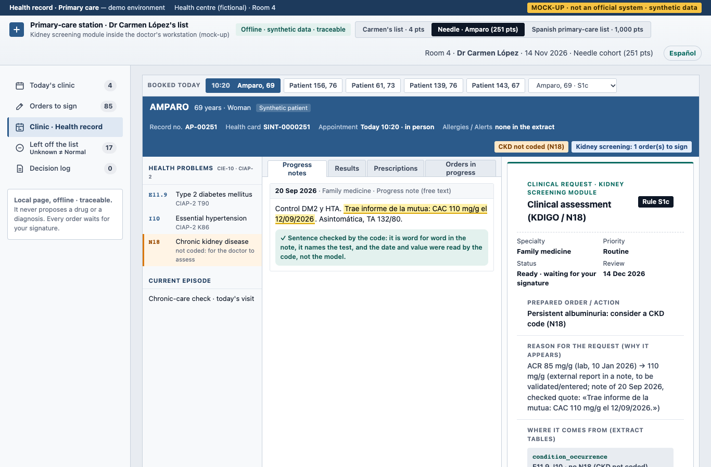

# Orders ready to sign

**1 in 7 people with diabetes or high blood pressure have signs of kidney damage hiding behind a normal blood test. 19 in 20 of them have never been told.**
Every morning, this tool reads a family doctor's list, finds those people, and prepares the next test for the doctor to sign. The computer does the checking; the doctor decides.



**Result on US national data (NHANES 2021–2023, 2,216 adults with diabetes or high blood pressure):** a filter that looks only at the kidney blood test (eGFR < 60) finds **48.1 %** (95 % CI 44.5–51.7 %) of the people with a kidney warning sign. The other 52 %, **143 per 1,000** adults (128–159), have albumin in their urine behind a normal blood test; the tool prepares a repeat urine test for each of them. Of all its repeat orders, **52.4 %** (44.1–60.6 %) were ≥ 30 again on a first-morning urine within 10 days (NHANES 2009–2010): a second positive, not yet the 3-month persistence a diagnosis needs.

**Try it, no install:** open [`index.html`](index.html), then *Open the doctor's screen*. **Reproduce the evaluation:**

```bash
pip install -r requirements-eval.txt && python3 eval/nhanes/fetch.py && python3 eval/nhanes/run.py && python3 eval/nhanes/people.py
```

---

## The problem, and who has it

Amparo is 69, with type 2 diabetes and high blood pressure. Her blood test says her kidneys filter well (eGFR 68), so her results are "acceptable". But a urine test found albumin (85 mg/g; normal is under 30), and a second high result (110 mg/g) came in a letter from her private insurer and was typed into a note, where no filter looks. Her record has no kidney diagnosis; she is not on the blood-pressure medicine that also protects the kidneys. *(Amparo is synthetic: patient 251 in our demo data.)*

From NHANES (CDC), survey-weighted, 95 % CI ([`eval/results/nhanes.md`](eval/results/nhanes.md) for the first row, [`eval/results/nhanes_people.md`](eval/results/nhanes_people.md) for the others):

| | Finding |
|---|---|
| **1 in 7** | adults with diabetes or high blood pressure have urine albumin ≥ 30 mg/g with eGFR ≥ 60 (143 per 1,000; 128–159; 2021–2023, n = 2,216) |
| **19 in 20** | of them (single-visit urine test) have never been told they have weak or failing kidneys (953 per 1,000; 904–977; n = 313) |
| **1 in 5** | of adults with diabetes, hypertension and urine albumin ≥ 30 mg/g on one visit behind an eGFR ≥ 60 were taking no ACE inhibitor or ARB (218 per 1,000; 151–304; 2017–2020, n = 204), the treatment KDIGO 2022 Rec. 1.2.1 recommends for this group (this count includes people who may have a reason not to take one) |

Spain has the same gap: 54 % of chronic kidney disease in 5,009 adults with type 2 diabetes in Spanish primary care was undiagnosed, "mainly in patients with isolated eGFR or uACR abnormalities" ([DIAMOND2, Prim Care Diabetes 2026](https://doi.org/10.1016/j.pcd.2026.02.007)). Urine albumin ≥ 10 mg/g predicts death independently of eGFR ([Matsushita et al., Lancet 2010](https://doi.org/10.1016/S0140-6736(10)60674-5)). The plain-words version: [`docs/THE_PROBLEM.md`](docs/THE_PROBLEM.md).

A decision-support pilot in Spanish primary care already showed the approach is feasible and cheap. In one health centre in Alicante–Sant Joan, prompts and pre-filled orders flagged 1,892 of 7,722 people; 1,774 (93.8 %) completed screening, 104 new CKD cases were found, and reagents cost EUR 11.14 per case detected ([López-Garrigós et al., Diagnostics 2025](https://doi.org/10.3390/diagnostics16010008), PMID 41515503). That pilot ran inside one laboratory system. This tool reads an OMOP-shaped or FHIR R4 extract (tested on synthetic data only) and also reads the free-text notes.

**Who has the problem:** the patient, who doesn't know; and the family doctor, who looks after many people with diabetes or hypertension and has no time to re-read every chart every morning. Care is bottlenecked on attention, not knowledge.

## What it does (method)


*Built from the code by [`docs/diagram/build.mjs`](docs/diagram/build.mjs); a 4:5 version for posts is [`docs/workflow_4x5.png`](docs/workflow_4x5.png).*

1. **It reads the list.** Each rule is one SQL query over an OMOP-shaped extract, with thresholds and sources in one table ([`rules/00_parametros.sql`](rules/00_parametros.sql)), signed by the project's physician:

| Group on screen | Rule | Condition | Source |
|---|---|---|---|
| Getting worse | **S3** | ≥ 3 eGFR over ≥ 12 months with slope < −5 ml/min/1.73 m²/year, or a fall in G category with a drop ≥ 25 % (same 3-value, 12-month requirement) | KDIGO 2012, rec. 2.1.3 |
| Getting worse | **S3c** | isolated eGFR fall > 20 % between the last two values | KDIGO 2024, PP 2.1.3 |
| No follow-up | **S1b** | last ACR ≥ 30 mg/g (≥ 3 mg/mmol), not repeated in > 6 months, no CKD code | KDIGO 2024, table 1; PP 1.1.3.2 |
| No follow-up | **S1c** | two abnormal ACRs ≥ 3 months apart, one a lab result and one from a note within 12 months: consider a CKD code | KDIGO 2024 (chronicity ≥ 3 months) |
| Test due | **S1a** | type 2 diabetes (ICD-10 E11), hypertension or eGFR < 60 with no ACR in > 12 months | PROT-AP ERC 2025 (Valencian protocol) |

2. **It prepares the next step:** the lab order, one line for the progress note and a review date, each with the reason, the number and the date. It never proposes a drug, and the diagnosis stays with the doctor: for two abnormal results ≥ 3 months apart it only asks the doctor to consider recording a CKD code.
3. **The doctor signs**, postpones, or dismisses with a reason. It stays quiet when it should: a test already ordered or recently repeated is not listed again, and a missing value or unknown unit is never treated as normal ("Unknown ≠ Normal").

**The AI part, and how it is held in check.** A small open model (Qwen3-4B-Instruct-2507, Apache-2.0) reads free-text notes for results typed there, such as Amparo's insurer report. It only *points to a numbered sentence*; the code copies that sentence, rejects negations, plans, family members and reference ranges, and reads the value and date itself. The rules then decide (rule N1, [`notas/verificar.py`](notas/verificar.py)). The model ran on synthetic notes and on published Spanish case reports (CodiEsp and LivingNER, CC BY 4.0; Modal, EU region); its outputs are recorded, and CI and the demo replay them without calling any model.

## Evaluation

**Pre-registered:** the protocol for the primary (2021–2023) and secondary (2009–2010) measures ([`docs/EVAL_PROTOCOL.md`](docs/EVAL_PROTOCOL.md)) was committed (15 Nov 2026, 23:19) and signed (23:21) before the evaluation code was added (23:26); the commit history shows the order. Changes after that are dated amendments; amendments 4–7 came after the first run. The awareness, treatment and population figures ("19 in 20", "1 in 5", 10.6 million) are descriptive analyses added after the run (amendment 6), not pre-registered. The rules ran unmodified.

**What we measured, and how.** Each NHANES participant becomes a one-visit extract in the same schema (eGFR by CKD-EPI 2021 from serum creatinine, urine ACR, diagnosed diabetes/hypertension), and the unchanged engine runs on it. Estimates use the survey design (MEC weights, strata, PSUs; Taylor linearisation; logit 95 % CI). Files are pinned by SHA-256 ([`eval/nhanes/MANIFEST.json`](eval/nhanes/MANIFEST.json)); there is no random step.

| Question | Metric | Result | Reference |
|---|---|---|---|
| How much does a blood-test-only filter miss? | Share of single-visit kidney markers (eGFR < 60 or ACR ≥ 30) found by "last eGFR < 60" | **481 per 1,000** (445–517) | baseline filter |
| How many people are behind an acceptable eGFR? | ACR ≥ 30 with eGFR ≥ 60, per 1,000 adults with diabetes or hypertension | **143 per 1,000** (128–159) | — |
| Is a repeat order worth it? (non-circular) | Engine's "repeat ACR" orders (all eGFR levels) ≥ 30 mg/g again on a first-morning urine within 10 days | **524 per 1,000** (441–606; n = 360) | not flagged but high on the 2nd sample: 13.5 per 1,000 |
| Do we read the CDC files correctly? | Figures in the CDC's analytic note for the 2009–2010 urine file | **7 of 8 reproduced exactly** | the 8th explained in [`eval/results/nhanes.md`](eval/results/nhanes.md) |

**What the result means:** on one visit, the engine's S1b threshold and the albuminuria reference are the same, so "the engine flags them" checks the pipeline on real values; it is not an accuracy claim. The size of the gap and the confirmation rate are the findings. Full tables: [`eval/results/nhanes.md`](eval/results/nhanes.md), [`eval/results/nhanes_people.md`](eval/results/nhanes_people.md).

**Error table** (amendment 9, descriptive, added after the pre-registered run; [`eval/results/nhanes_errors.md`](eval/results/nhanes_errors.md)). Published evaluations of sepsis alerts report every kind of error at the operating point, not one number, and ask what an alert adds to what clinicians already do (Wong et al., JAMA Intern Med 2021, doi:10.1001/jamainternmed.2021.2626). The same here, on NHANES 2009–2010 (1,933 people with a second urine sample; reference: second ACR ≥ 30 mg/g, which the rules never see):

| | Engine (repeat-ACR order) | Blood-test filter (eGFR < 60) | Both together |
|---|---|---|---|
| Sensitivity | 86.8 % (81.0–91.1) | 32.8 % (24.5–42.3) | 90.2 % (86.3–93.1) |
| Specificity | 92.4 % (89.9–94.4) | 89.0 % (87.1–90.6) | 83.0 % (81.0–84.8) |
| PPV (order confirmed) | 52.4 % (44.1–60.6) | 22.1 % (17.3–27.8) | 33.7 % (29.4–38.2) |
| Missed per 1,000 people | 11.5 (7.7–17.1) | 58.7 (45.0–76.3) | 8.5 (6.0–12.2) |
| False alarms per 1,000 people | 69.0 (51.4–92.0) | 100.8 (86.4–117.3) | 155.5 (139.7–172.7) |
| Orders per confirmed case | 1.91 (1.65–2.27) | 4.52 (3.59–5.77) | 2.97 (2.62–3.40) |

Of the people whose second sample is high, the blood-test filter misses 67.2 % (57.7–75.5); the engine orders a repeat for 85.5 % (79.3–90.0) of those. The 11.5 missed per 1,000 people on the list are the same 28 people as the 13.5 per 1,000 of those not flagged (table above): different denominators. **Read with care:** the engine's flag is ACR ≥ 30 on the first sample, so its sensitivity and specificity here are mostly a 10-day test-retest agreement of the same urine test, not discrimination; and the blood-test filter was never meant to find albuminuria, so this shows where the markers sit, not a fair contest. Not measured: 3-month persistence, calibration (the rules give orders, not scores), other countries (cf. Reyna et al. 2020 on held-out hospitals), outcomes after a signed order (cf. Adams et al. 2022, TREWS), and how many findings the note reader misses.

**Software verification on synthetic data** (labels written before running, by the AI assistant that also wrote the rules: verification of the code against the signed rules, not clinical validation):

| Set | Engine | Basic filter (last eGFR < 60) |
|---|---|---|
| Spanish primary-care list, 1,000 synthetic adults (with notes, Qwen3-4B recorded) | 1,000 / 1,000 correct · 0 false alerts · 0 missed | 49 false alerts · 107 missed (circular: graded against labels that follow the engine's own rules) |
| 20 hard cases (23 patients: thresholds, units, duplicates, pending orders) | 23 / 23 | — |
| Note reader, development set / needle cases | 12 / 12 · 6 / 6 · 0 wrong exclusions | — |

`python3 -m pytest -q` runs the test suite (rules, suppression, extract validation, note checks, NHANES estimators, the numbers on the landing page and in this README); `npm run test:ui` clicks through the screen in Spanish and sweeps every view of every cohort in English.

**When the result stops being useful:** single measurements (a CKD diagnosis needs > 3 months); the second urine sample was a first-morning void within 10 days, not a 3-month repeat; self-reported diagnoses; about a third of eligible people had no creatinine or ACR and were dropped (complete cases); US population, while the tool is designed for Spanish primary care, where we have no public data to test it.

## Who benefits, and who could be harmed

- **Benefits:** people like Amparo, whose kidney damage is found while it can still be slowed; family doctors, whose checking is done before the clinic opens.
- **Extra tests:** about half of the repeat orders will come back normal: a second sample, some worry, a small cost.
- **False reassurance:** not being on the list does not mean "cleared"; the tool sees only what is in the record.
- **Wrong setting:** evidence is from the US. A rule error could add or miss orders for a whole list, which is why every rule has a test, every order shows its reason, and nothing happens without the doctor's signature (in this prototype the decision log is kept in the browser only; no order is transmitted).
- **Privacy:** no real patient data was used anywhere. In production the rules would run inside the health department's network; the note reader would run there too (designed, not built).

## Limitations

Full audit trail, real-text error rates, recall measurements, and round-by-round checks live in [`docs/LIMITATIONS.md`](docs/LIMITATIONS.md).

- **Prototype, not an EHR integration:** reads OMOP-shaped or synthetic FHIR R4 extracts (`fhir/leer_fhir.py`); never checked with the HL7 validator, writes nothing back to the record, and omits combination SGLT2 inhibitors (`A10BD`).
- **Synthetic validation is not clinically blind:** synthetic charts and labels were authored by the AI assistant that wrote the rules; independent physician review (200 blind charts) and round-13 fixes ([`docs/FIRMA_VUELTA_13.md`](docs/FIRMA_VUELTA_13.md)) are pending external validation.
- **Cross-sectional US evidence only:** NHANES has one visit and no notes, drugs, or pending orders, so S1c, suppression, and the note reader never ran on real data; confirmation (52.4 %) reflects 10-day repeat testing rather than 3-month CKD persistence.
- **Low real-text note recall:** on published Spanish hospital case reports (CodiEsp/LivingNER), the Qwen3-4B + `verificar.py` pipeline misses most lab values and dates, so it acts strictly as an additive grey-line aid rather than a replacement for structured lab feeds.
- **Keyword-bounded note guard:** [`notas/verificar.py`](notas/verificar.py) blocks known Spanish prompt injections, dipsticks, 24 h albumin collections, and inequality bounds, but reworded attacks outside its regex patterns could bypass the filter.

## What we would do with another month

1. A blind test: an independent family doctor labels 200 synthetic charts without seeing the rules' output.
2. Apply for access to a Spanish primary-care research database to measure the same gap on Spanish data.
3. Measure persistence properly: two ACRs ≥ 3 months apart in longitudinal data, not 10 days.
4. Pilot the morning list read-only in one health centre, counting orders signed, dismissed (and why), and confirmed.
5. Run the FHIR R4 reader on a real (test) export from a regional system, check it with the HL7 validator, and write the signed order back as a FHIR ServiceRequest.

## Repository map

| Path | What |
|---|---|
| [`index.html`](index.html) | English landing page (the problem, the evidence) |
| [`ui/index.html`](ui/index.html) | The doctor's screen (`?lang=en` for English); static, offline |
| [`ejecutar.py`](ejecutar.py) | Runs the rules on an extract → `ui/pedidos.json` |
| [`rules/`](rules/) | One SQL file per rule, plus suppression |
| [`notas/`](notas/) | Note reader: prompt, model call (Modal), code checks |
| [`eval/nhanes/`](eval/nhanes/) | External evaluation on NHANES |
| [`data/synthetic/`](data/synthetic/) | Synthetic extracts with data cards |
| [`docs/`](docs/) | Protocol, problem, judges' map, claims, [pre-registration timeline](docs/PREREGISTRO.md) |

## Attribution

- **Data:** NHANES 2009–2010, 2017–March 2020 and August 2021–August 2023 (CDC/NCHS, public). All patients in the demo are synthetic.
- **Guidelines and equations:** KDIGO 2012, 2022 and 2024; Valencian primary-care CKD protocol (PROT-AP ERC 2025); CKD-EPI 2021 creatinine equation ([Inker et al., NEJM 2021](https://doi.org/10.1056/NEJMoa2102953)); synthetic list calibrated with published Spanish cohorts (IBERICAN, BDCAP, Girona Sud, BIG-PAC; sources in [`data/synthetic/cupo_espanol_1000/DATA_CARD.md`](data/synthetic/cupo_espanol_1000/DATA_CARD.md)).
- **Models:** Qwen3-4B-Instruct-2507 (Alibaba Qwen, Apache-2.0), run on Modal; Qwen 3.8 27B (via RWTHgpt) as a comparison reader.
- **Libraries:** Python standard library and SQLite (engine); pytest; pandas and SciPy (evaluation); playwright-core (screen tests); vLLM 0.11.0 and Hugging Face Transformers 4.57.1 (Apache-2.0) serve the note reader, with weights from Hugging Face, on Modal.
- **AI tools:** Claude (Anthropic) wrote most of the code, analysis scripts and documentation under the author's direction; GPT-6.1 Sol and Claude sub-agents reviewed code and attacked the note checks. Every clinical rule and threshold was chosen and signed by the author, who can explain each one.
- **Origin:** first prototyped at a hackathon in Spain (13–15 Nov 2026); the evaluation, English version and landing page were built afterwards.

Author: Dr Ahmed Zayed (MB BCh), M.Sc. student in Applied Health Informatics and Digital Medicine, RWTH Aachen.

## License

Code: [MIT](LICENSE). Third-party data keeps its own licence: the CodiEsp and LivingNER corpora (CC BY 4.0) are fetched by the evaluation scripts, not shipped here. Model weights (Qwen3-4B-Instruct-2507, Apache-2.0) are not included.
